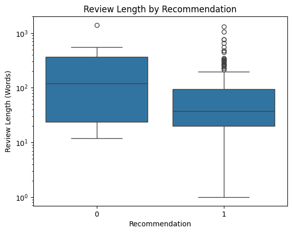
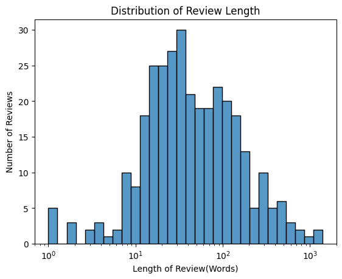
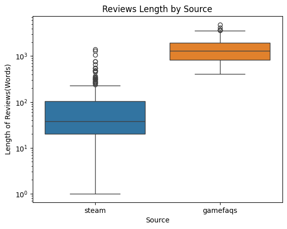

# Statistical Analysis of Persona Game Reviews

## Introduction

This project focuses on the statistical analysis of user reviews of Persona video games collected from two platforms: Steam and GameFAQs.

The main objective is to examine review characteristics, particularly review length, and investigate whether review length is associated with user ratings or recommendations.

The analysis covers the following aspects:

- Review length distribution and descriptive statistics.
- Differences in review length between positively and negatively recommended Steam reviews.
- Correlation between review length and user ratings on GameFAQs.
- Comparison of review length between Steam and GameFAQs.
- Comparison of review statistics across individual games.

Python libraries such as Pandas, NumPy, Matplotlib, Seaborn, and SciPy are used for data processing, visualization, and statistical testing.

## Steam Review Collection

Steam reviews were collected using a Python script that sends HTTP requests to the Steam review API.

The collection process uses the following components:

- **Requests:** Sends HTTP requests to retrieve review data.
- **Pagination:** Uses a cursor to retrieve reviews across multiple API responses.
- **Review limits:** Controls the maximum number of reviews requested for each game.
- **Duplicate prevention:** Tracks previously encountered review identifiers to avoid collecting the same review multiple times.
- **Response validation:** Checks HTTP responses and processes the returned JSON data.

The collected reviews provide information about review text, recommendation status, and the corresponding game.

This approach enables automated data collection while reducing the risk of duplicate records.


```python
import requests
import pandas as pd
import json
import re
import time

def get_steam_reviews(appid, n=100):
    url = "https://api.steampowered.com/IUserReviewsService/GetAppReviews/v1/"

    headers = {
        "User-Agent": "student-project/1.0",
        "Accept": "application/json"
    }

    reviews = []
    seen_ids = set()
    seen_cursors = set()
    cursor = "*"

    while len(reviews) < n:
        params = {
            "input_json": json.dumps({
                "appid": appid,
                "num_per_page": min(100, n - len(reviews)),
                "cursor": cursor,
                "filter": "recent"
            })
        }

        response = requests.get(
            url,
            headers=headers,
            params=params,
            timeout=15
        )
        response.raise_for_status()

        data = response.json().get("response", {})
        batch = data.get("reviews", [])

        if not batch:
            break

        for item in batch:
            review_id = item.get("recommendationid")

            if review_id is not None:
                unique_id = str(review_id)
            else:
                unique_id = (
                    str(appid),
                    item.get("language", ""),
                    item.get("review", "").strip()
                )

            if unique_id in seen_ids:
                continue

            seen_ids.add(unique_id)

            review_text = re.sub(
                r"\s+",
                " ",
                item.get("review", "")
            ).strip()

            reviews.append({
                "appid": appid,
                "review": review_text,
                "language": item.get("language", ""),
                "voted_up": item.get("voted_up")
            })

            if len(reviews) >= n:
                break

        next_cursor = data.get("cursor")

        if not next_cursor or next_cursor == cursor:
            break

        if next_cursor in seen_cursors:
            break

        seen_cursors.add(next_cursor)
        cursor = next_cursor

        time.sleep(0.2)

    return pd.DataFrame(
        reviews,
        columns=["appid", "review", "language", "voted_up"]
    )


appids = [1809700, 1113000, 2161700, 1687950]

all_reviews = []

for appid in appids:
    df = get_steam_reviews(appid, n=100)
    all_reviews.append(df)

reviews_df = pd.concat(all_reviews, ignore_index=True)

reviews_df = reviews_df.drop_duplicates(
    subset=["appid", "review", "language"]
).reset_index(drop=True)

reviews_df.to_csv(
    "steam_reviews_persona.csv",
    index=False,
    encoding="utf-8-sig"
)

print(reviews_df.shape)
print(reviews_df["voted_up"].value_counts())
```

    (325, 4)
    voted_up
    True     304
    False     21
    Name: count, dtype: int64
    

## GameFAQs Review Collection

GameFAQs reviews were collected using a Python script designed to extract structured information from review listing pages and individual review pages.

The script supports three collection modes:

- **Requests mode:** Retrieves HTML pages using HTTP requests.
- **Safari mode:** Retrieves HTML through a dedicated Safari browser tab.
- **Offline mode:** Reuses previously saved HTML pages without requesting them again.

The collection procedure includes:

- Extracting review identifiers, authors, game titles, ratings, and review text.
- Recording publication and update dates.
- Validating ratings against the original 1–10 rating scale.
- Checking consistency between ratings shown on listing pages and individual review pages.
- Identifying review language using a character-based heuristic.
- Preventing duplicate review identifiers.
- Recording collection methods and timestamps.

The script also saves intermediate results and collection coverage information, allowing the collected data to be validated and processed later.

Language identification is based on the dominant writing system and should therefore be treated as an approximation rather than a comprehensive language classification method.


```python
"""GameFAQs review collection. Modes: --safari, --offline; default: requests.

Safari mode reads HTML from a dedicated tab in the user's running Safari session.
It does not represent successful collection through requests.
"""
import csv
import json
import re
import subprocess
import sys
import time
from datetime import datetime, timezone
from pathlib import Path
from urllib.parse import urljoin
from urllib.robotparser import RobotFileParser

import requests
from bs4 import BeautifulSoup

ROOT = Path.cwd()
BASE = 'https://gamefaqs.gamespot.com'
AGENT = 'PersonaSISCourseProject/1.0 (educational HTML collection)'
GAMES = [
    ('persona_3', 'Persona 3', '/ps2/932312-shin-megami-tensei-persona-3/reviews'),
    ('persona_4', 'Persona 4', '/ps2/945498-shin-megami-tensei-persona-4/reviews'),
    ('persona_5', 'Persona 5', '/ps4/835628-persona-5/reviews'),
    ('persona_3_portable', 'Persona 3 Portable', '/psp/971508-shin-megami-tensei-persona-3-portable/reviews'),
    ('persona_3_fes', 'Persona 3 FES', '/ps2/937269-shin-megami-tensei-persona-3-fes/reviews'),
    ('persona_3_reload', 'Persona 3 Reload', '/xbox-series-x/409940-persona-3-reload/reviews'),
    ('persona_4_golden', 'Persona 4 Golden', '/vita/641695-persona-4-golden/reviews'),
    ('persona_5_royal', 'Persona 5 Royal', '/ps4/260936-persona-5-royal/reviews'),
]


def apple_script(script):
    return subprocess.check_output(['osascript', '-e', script], text=True, timeout=25).strip()


def save_csv(name, rows):
    if not rows:
        return
    with (ROOT / 'data' / name).open('w', newline='', encoding='utf-8-sig') as f:
        writer = csv.DictWriter(f, fieldnames=list(rows[0]))
        writer.writeheader()
        writer.writerows(rows)


def get_page(url, key, mode, robot, tab):
    folder = ROOT / 'data/browser_html'
    path = folder / (key + '.html')
    meta_path = path.with_suffix('.json')
    # Reuse previously captured successful pages during an interrupted collection.
    if mode in ['safari', 'offline'] and path.exists() and meta_path.exists() and '</html>' in path.read_text().lower():
        meta = json.loads(meta_path.read_text())
        if meta['url'] != url:
            raise ValueError('Cached URL does not match: ' + key)
        return BeautifulSoup(path.read_text(), 'html.parser'), meta
    if mode == 'offline':
        raise FileNotFoundError(path)
    if not robot.can_fetch(AGENT, url):
        raise ValueError('robots.txt disallows ' + url)
    time.sleep(1.5)
    if mode == 'safari':
        target = f'tab {tab[1]} of window id {tab[0]}'
        apple_script(f'tell application "Safari" to set URL of {target} to {json.dumps(url)}')
        time.sleep(0.5)
        for attempt in range(40):
            result = apple_script(f'tell application "Safari" to return (URL of {target}) & linefeed & (source of {target})')
            actual_url, _, html = result.partition('\n')
            soup = BeautifulSoup(html, 'html.parser')
            canonical = soup.select_one('link[rel="canonical"]')
            if actual_url == url and canonical and canonical.get('href') == url and soup.select_one('h1.page-title') and '</html>' in html.lower():
                break
            time.sleep(0.5)
        else:
            raise RuntimeError('Browser page is unavailable or shows a challenge: ' + url)
    else:
        r = requests.get(url, headers={'User-Agent': AGENT}, timeout=30)
        r.raise_for_status()
        html = r.text
        soup = BeautifulSoup(html, 'html.parser')
        if not soup.select_one('h1.page-title'):
            raise ValueError('Expected game page is missing')
    meta = {'url': url, 'collected_at_utc': datetime.now(timezone.utc).isoformat(),
            'collection_method': 'safari_browser_html' if mode == 'safari' else 'requests_html'}
    folder.mkdir(parents=True, exist_ok=True)
    path.write_text(html, encoding='utf-8')
    meta_path.write_text(json.dumps(meta, indent=2), encoding='utf-8')
    return soup, meta


def parse_review(soup, item, meta):
    heading = soup.select_one('div.body > div.ffaq > h3')
    if heading is None:
        raise ValueError('Review title/body layout not found')
    body = heading.find_parent('div', class_='body')
    blocks = body.find_all('div', class_='ffaq', recursive=False)
    text = ' '.join(' '.join(b.get_text(' ', strip=True).split()) for b in blocks[1:]).strip()
    if not text:
        raise ValueError('Empty review body')
    score = body.select_one('.rev_score')
    if score is None or float(score.get_text()) != item['rating']:
        raise ValueError('Listing/detail score mismatch: ' + item['source_url'])
    header = next((b for b in soup.select('div.body.ffaq') if 'Reviewed:' in b.get_text()), None)
    if header is None:
        raise ValueError('Publication date not found')
    dates = re.search(r'Reviewed:\s*(\d{2}/\d{2}/\d{4})(?:\s*\|\s*Updated:\s*(\d{2}/\d{2}/\d{4}))?', header.get_text(' ', strip=True))
    if dates is None:
        raise ValueError('Unrecognized review date')
    item = item.copy()
    item['review_title'] = heading.get_text(' ', strip=True)
    item['review_text'] = text
    item['review_date'] = datetime.strptime(dates[1], '%m/%d/%Y').date().isoformat()
    item['updated_date'] = datetime.strptime(dates[2], '%m/%d/%Y').date().isoformat() if dates[2] else ''
    release = next((li.get_text(' ', strip=True) for li in body.select('li') if 'Product Release:' in li.get_text()), '')
    item['product_release'] = release.removeprefix('Product Release:').strip()
    item['review_chars'] = len(text)
    item['rating_normalized'] = item['rating'] / 10
    item['language'] = 'ru' if len(re.findall('[А-Яа-яЁё]', text)) > len(re.findall('[A-Za-z]', text)) else 'en'
    item['language_method'] = 'dominant_script_heuristic'
    item['collected_at_utc'] = meta['collected_at_utc']
    item['collection_method'] = meta['collection_method']
    return item


def collect(mode):
    (ROOT / 'data/browser_html').mkdir(parents=True, exist_ok=True)
    robot = RobotFileParser()
    robot.parse((ROOT / 'data/raw/robots.txt').read_text().splitlines())
    tab = None
    if mode == 'safari':
        # Use a new dedicated tab, not whatever tab the user later selects.
        result = apple_script('tell application "Safari"\nset w to front window\nset t to make new tab at end of tabs of w with properties {URL:"about:blank"}\nset current tab of w to t\nreturn (id of w as text) & "," & (index of t as text)\nend tell')
        tab = tuple(map(int, result.split(',')))
    rows, coverage, seen = [], [], set()
    for game_id, title, path in GAMES:
        url = BASE + path
        soup, listing_meta = get_page(url, game_id + '_list', mode, robot, tab)
        expected_name = 'Shin Megami Tensei: ' + title if game_id in ['persona_3','persona_4','persona_3_portable','persona_3_fes'] else title
        if expected_name not in soup.select_one('h1.page-title').get_text():
            raise ValueError('Unexpected game title for ' + game_id)
        cards = soup.select('ol.reviews > li[data-score]')
        if not cards:
            raise ValueError('No user review cards for ' + game_id)
        print(f'{title}: {len(cards)} listed reviews', flush=True)
        game_count = 0
        for index, card in enumerate(cards, 1):
            link = card.select_one('a[href*="/reviews/"]')
            if link is None:
                raise ValueError('Review link not found')
            review_id = link['href'].rsplit('/', 1)[1]
            if review_id in seen:
                continue
            item = {'game_id': game_id, 'game_title': title, 'source': 'gamefaqs',
                    'review_id': review_id, 'author': card['data-author'],
                    'platform': card['data-platform'], 'rating': float(card['data-score']), 'rating_max': 10,
                    'source_url': urljoin(BASE, link['href']), 'listing_url': url,
                    'listing_updated_date': card['data-updated'],
                    'review_type_code': card.parent.get('data-review-type',''),
                    'edition_scope': 'exact', 'merge_eligible': True}
            if not 1 <= item['rating'] <= 10:
                raise ValueError('Score outside 1-10 scale')
            detail, meta = get_page(item['source_url'], 'review_' + review_id, mode, robot, tab)
            row = parse_review(detail, item, meta)
            rows.append(row); seen.add(review_id); game_count += 1
            save_csv('reviews_gamefaqs.csv', rows)
            print(f'  {index}/{len(cards)} ID {review_id}, {row["review_chars"]} characters', flush=True)
        coverage.append({'game_id': game_id, 'game_title': title, 'listed_reviews': len(cards),
                         'collected_reviews': game_count, 'listing_url': url,
                         'collection_method': listing_meta['collection_method']})
        save_csv('coverage_gamefaqs.csv', coverage)
    print('TOTAL:', len(rows), flush=True)
    return rows


if __name__ == '__main__':
    mode = 'offline' if '--offline' in sys.argv else ('safari' if '--safari' in sys.argv else 'requests')
    collect(mode)

```


    ---------------------------------------------------------------------------

    HTTPError                                 Traceback (most recent call last)

    Cell In[92], line 178
        176 if __name__ == '__main__':
        177     mode = 'offline' if '--offline' in sys.argv else ('safari' if '--safari' in sys.argv else 'requests')
    --> 178     collect(mode)
    

    Cell In[92], line 138, in collect(mode)
        136 for game_id, title, path in GAMES:
        137     url = BASE + path
    --> 138     soup, listing_meta = get_page(url, game_id + '_list', mode, robot, tab)
        139     expected_name = 'Shin Megami Tensei: ' + title if game_id in ['persona_3','persona_4','persona_3_portable','persona_3_fes'] else title
        140     if expected_name not in soup.select_one('h1.page-title').get_text():
    

    Cell In[92], line 79, in get_page(url, key, mode, robot, tab)
         77 else:
         78     r = requests.get(url, headers={'User-Agent': AGENT}, timeout=30)
    ---> 79     r.raise_for_status()
         80     html = r.text
         81     soup = BeautifulSoup(html, 'html.parser')
    

    File ~\AppData\Local\Programs\Python\Python313\Lib\site-packages\requests\models.py:1024, in Response.raise_for_status(self)
       1019     http_error_msg = (
       1020         f"{self.status_code} Server Error: {reason} for url: {self.url}"
       1021     )
       1023 if http_error_msg:
    -> 1024     raise HTTPError(http_error_msg, response=self)
    

    HTTPError: 403 Client Error: Forbidden for url: https://gamefaqs.gamespot.com/ps2/932312-shin-megami-tensei-persona-3/reviews


## GameFAQs Data Cleaning and Validation

After collection, the GameFAQs dataset was processed to identify duplicate cross-posts and validate data completeness.

The cleaning procedure includes:

1. **Collection coverage validation:** Verifies that all eight selected games are represented and that collected review counts match the listing counts.
2. **Review identifier validation:** Checks that each collected review has a unique identifier.
3. **Missing data validation:** Checks whether review texts and publication dates are present.
4. **Rating validation:** Ensures that numerical ratings fall within the original 1–10 scale.
5. **Cross-post detection:** Identifies repeated reviews based on the same game, author, complete review text, and rating.

When an exact cross-post is identified, the earliest published version is retained, while later copies are excluded from the cleaned dataset.

The original dataset is preserved separately, and excluded records are documented in an additional CSV file.

The script also generates summary statistics by game and a JSON validation report containing information about data completeness, duplicate handling, and collection methods.

This procedure improves dataset consistency and provides a reproducible record of the cleaning decisions.


```python
"""Remove exact same-author cross-posts and summarize the saved GameFAQs dataset."""
import csv
import json
import statistics
from pathlib import Path
from collections import Counter

ROOT = Path.cwd()
DATA = ROOT / 'data'


def read_csv(name):
    with (DATA / name).open(encoding='utf-8-sig', newline='') as f:
        return list(csv.DictReader(f))


def write_csv(name, rows, fields=None):
    with (DATA / name).open('w', encoding='utf-8-sig', newline='') as f:
        writer = csv.DictWriter(f, fieldnames=fields or list(rows[0]))
        writer.writeheader()
        writer.writerows(rows)


def prepare():
    rows = read_csv('reviews_gamefaqs.csv')
    coverage = read_csv('coverage_gamefaqs.csv')
    if len(coverage) != 8:
        raise ValueError('The collection of eight games is not complete')
    if len({r['review_id'] for r in rows}) != len(rows):
        raise ValueError('Duplicate review IDs')
    for c in coverage:
        count = sum(r['game_id'] == c['game_id'] for r in rows)
        if count != int(c['listed_reviews']) or count != int(c['collected_reviews']):
            raise ValueError('Listing/collection count mismatch: ' + c['game_title'])
    if any(not r['review_text'].strip() or not r['review_date'] for r in rows):
        raise ValueError('A review text or publication date is missing')
    if any(not 1 <= float(r['rating']) <= 10 for r in rows):
        raise ValueError('A score is outside the source scale')

    # Same author, same game, exactly the same normalized text and score.
    # Keep the earliest published version and preserve all originals in the raw CSV.
    first, excluded = {}, []
    for row in sorted(rows, key=lambda r: (r['review_date'], int(r['review_id']))):
        key = (row['game_id'], row['author'], row['review_text'], row['rating'])
        if key not in first:
            first[key] = row
        else:
            old = first[key]
            excluded.append({'removed_review_id': row['review_id'], 'retained_review_id': old['review_id'],
                             'game_id': row['game_id'], 'author': row['author'],
                             'removed_platform': row['platform'], 'retained_platform': old['platform'],
                             'reason': 'Same author, game, complete text and rating; later cross-post'})
    keep = {r['review_id'] for r in first.values()}
    clean = [r for r in rows if r['review_id'] in keep]
    write_csv('reviews_gamefaqs_clean.csv', clean)
    fields = ['removed_review_id','retained_review_id','game_id','author','removed_platform','retained_platform','reason']
    write_csv('duplicate_crossposts.csv', excluded, fields)
    summaries = []
    for c in coverage:
        group = [r for r in clean if r['game_id'] == c['game_id']]
        ratings = [float(r['rating']) for r in group]
        lengths = [int(r['review_chars']) for r in group]
        summaries.append({'game_id': c['game_id'], 'game_title': c['game_title'],
                          'listed_reviews': int(c['listed_reviews']), 'clean_reviews': len(group),
                          'mean_rating': round(statistics.mean(ratings), 4),
                          'median_rating': statistics.median(ratings),
                          'mean_review_chars': round(statistics.mean(lengths), 2)})
    write_csv('game_summary_gamefaqs.csv', summaries)
    validation = {'raw_reviews': len(rows), 'clean_reviews': len(clean), 'excluded_crossposts': len(excluded),
                  'games': len(coverage), 'listing_counts_match': True, 'missing_scores': 0,
                  'missing_publication_dates': 0, 'duplicate_ids': 0,
                  'collection_methods': dict(Counter(r['collection_method'] for r in rows)),
                  'language_heuristic': dict(Counter(r['language'] for r in clean))}
    (DATA / 'validation_gamefaqs.json').write_text(json.dumps(validation, indent=2), encoding='utf-8')
    print(json.dumps(validation, indent=2))
    return clean


if __name__ == '__main__':
    prepare()

```


```python
import pandas as pd
import numpy as np
import matplotlib.pyplot as plt
import seaborn as sns
import warnings as wr
import os
os.chdir(os.getcwd())
print("Working directory:", os.getcwd())
steam = pd.read_csv("steam_reviews_persona.csv")
gamefaq = pd.read_csv("reviews_gamefaqs_clean.csv")
game_names = {
    1809700 : "persona_3_portable",
    1113000 : "persona_4_golden",
    2161700 : "persona_3_reload",
    1687950 : "persona_5_royal",
}
steam["game"] = steam["appid"].map(game_names)
steam["source"] = "steam"
steam = steam.drop(columns="appid")
gamefaq = gamefaq.rename(columns={"game_id":"game"})
gamefaq = gamefaq.rename(columns={"review_text":"review"})
gamefaq = gamefaq.drop(columns=["game_title", "review_id", "review_type_code", "author", "platform", "source_url", "listing_url", "listing_updated_date", "edition_scope", "merge_eligible", "review_title", "review_date", "updated_date", "product_release", "review_chars","rating_normalized", "language_method", "collected_at_utc", "collection_method"])
gamefaq["language"] = gamefaq["language"].replace("en", "english")

```

    Working directory: C:\Users\Kaba
    

## Data Collection and Preprocessing

Two datasets were used in this analysis: Steam reviews and GameFAQs reviews.

The Steam dataset contains user reviews, recommendation indicators (`voted_up`), language information, and game identifiers. Game identifiers were mapped to game names to make the dataset easier to interpret.

The GameFAQs dataset contains review texts and numerical ratings. Column names were standardized to ensure compatibility with the Steam dataset. Unnecessary metadata columns were removed, while the original rating and maximum rating values were retained.

Both datasets were assigned a common structure, including the following variables:

- `review` — review text.
- `game` — game identifier or name.
- `source` — platform from which the review was collected.
- `language` — review language.

The datasets were prepared for further statistical analysis.

## Data Quality Assessment

Before conducting the analysis, both datasets were examined for missing values, duplicate rows, and data types.

The Steam dataset contains no missing values or complete duplicate rows. Its variables have appropriate data types: review text and categorical variables are stored as objects, while the recommendation indicator is initially stored as a Boolean value.

The GameFAQs dataset also contains no missing values or complete duplicate rows. Review ratings are stored as floating-point numbers, while the maximum rating is stored as an integer.

These checks help ensure that the datasets are structurally consistent and ready for statistical analysis.


```python
print("Missing values(Steam):")
display(steam.isna().sum())

print("Number of duplicate rows(Steam):")
print(steam.duplicated().sum())

print("Data types(Steam):")
display(steam.dtypes)

print("Missing values:")
display(gamefaq.isna().sum())

print("Number of duplicate rows:")
print(gamefaq.duplicated().sum())

print("Data types:")
display(gamefaq.dtypes)
```

    Missing values(Steam):
    


    review      0
    language    0
    voted_up    0
    game        0
    source      0
    dtype: int64


    Number of duplicate rows(Steam):
    0
    Data types(Steam):
    


    review      object
    language    object
    voted_up      bool
    game        object
    source      object
    dtype: object


    Missing values:
    


    game          0
    source        0
    rating        0
    rating_max    0
    review        0
    language      0
    dtype: int64


    Number of duplicate rows:
    0
    Data types:
    


    game           object
    source         object
    rating        float64
    rating_max      int64
    review         object
    language       object
    dtype: object


```python
steam["review_len"] = steam["review"].str.len()
gamefaq["review_len"] = gamefaq["review"].str.len()
steam['word_count'] = steam['review'].str.split().str.len()
gamefaq['word_count'] = gamefaq['review'].str.split().str.len()
```

## Review Length Calculation

To examine review length, two additional variables were calculated:

- `review_len` — the number of characters in a review.
- `word_count` — the number of words in a review.

Both measurements were calculated separately for the Steam and GameFAQs datasets using the review text.

The `word_count` variable is used as the primary measure of review length in the subsequent statistical analysis. It provides a more interpretable measure of how much text users write, regardless of differences in individual word lengths.

## Correlation Analysis: GameFAQs

This section examines whether review length is associated with user ratings on GameFAQs.

The analysis uses three correlation methods:

- **Pearson correlation** measures the strength and direction of a linear relationship.
- **Spearman correlation** measures the strength and direction of a monotonic relationship using ranked values.
- **Kendall's Tau** measures rank association and provides an additional non-parametric assessment.

Before interpreting the results, the rating scale was checked. All 177 GameFAQs reviews use a maximum rating of 10, meaning that the original rating values are directly comparable.


```python
from scipy.stats import pearsonr, spearmanr, kendalltau, pointbiserialr
pearson = pearsonr(
    gamefaq['word_count'],
    gamefaq['rating']
)
spearman = spearmanr(
    gamefaq['word_count'],
    gamefaq['rating']
)
kendall = kendalltau(
    gamefaq['word_count'],
    gamefaq['rating']
)

print("Pearson:", pearson)
print("Spearman:", spearman)
print("Kendall:", kendall)
```

    Pearson: PearsonRResult(statistic=np.float64(0.09965026177875748), pvalue=np.float64(0.1869504301884556))
    Spearman: SignificanceResult(statistic=np.float64(0.07970700055114424), pvalue=np.float64(0.2916091253389889))
    Kendall: SignificanceResult(statistic=np.float64(0.059057869209802466), pvalue=np.float64(0.29427721526003225))
    

### Interpretation of Results

The correlation coefficients indicate a weak positive association between review length and user ratings.

- Pearson correlation: r = 0.100, p = 0.187.
- Spearman correlation: ρ = 0.080, p = 0.292.
- Kendall correlation: τ = 0.059, p = 0.294.

All three p-values are greater than the conventional significance level of 0.05.

Therefore, the analysis does not provide sufficient statistical evidence of a significant relationship between review length and user ratings on GameFAQs.

Although all three coefficients are positive, their magnitudes are very small. This suggests that review length is not meaningfully associated with the numerical rating in this sample.

## Review Length and Recommendation on Steam

This section investigates whether the length of Steam reviews differs depending on whether users recommend a game.

Reviews are divided into two groups:

- Positive reviews (`voted_up = 1`).
- Negative reviews (`voted_up = 0`).

Descriptive statistics are calculated for both groups, including the number of observations, median review length, and interquartile range (IQR).

The Mann–Whitney U test is then applied to determine whether the distributions of review lengths differ statistically between the two groups.

This non-parametric test is appropriate for comparing two independent groups without assuming that the data follows a normal distribution.


```python
from scipy.stats import mannwhitneyu


data = steam.dropna(subset=["voted_up", "word_count"])

positive = data[data["voted_up"] == 1]["word_count"]
negative = data[data["voted_up"] == 0]["word_count"]

print("Positive:", len(positive))
print("Negative:", len(negative))

print("\nPositive median:", positive.median())
print("Negative median:", negative.median())

print("\nPositive IQR:",
      positive.quantile(0.75) - positive.quantile(0.25))

print("Negative IQR:",
      negative.quantile(0.75) - negative.quantile(0.25))

print("\nMedian difference:",
      negative.median() - positive.median())

result = mannwhitneyu(
    negative,
    positive,
    alternative="two-sided",
    method="auto"
)

effect_size = (
    2 * result.statistic /
    (len(negative) * len(positive))
) - 1

print("\nMann-Whitney U:", result.statistic)
print("P-value:", result.pvalue)
print("Effect size:", effect_size)
```

    Positive: 304
    Negative: 21
    
    Positive median: 37.5
    Negative median: 121.0
    
    Positive IQR: 75.25
    Negative IQR: 347.0
    
    Median difference: 83.5
    
    Mann-Whitney U: 4317.5
    P-value: 0.006899585357912206
    Effect size: 0.3526002506265664
    

### Interpretation of Results

The dataset contains 304 positive reviews and 21 negative reviews.

The median review length is:

- Positive reviews: 37.5 words.
- Negative reviews: 121 words.

The median difference is 83.5 words, indicating that negative reviews tend to be substantially longer in this sample.

The interquartile ranges are also different:

- Positive reviews: 75.25 words.
- Negative reviews: 347 words.

The Mann–Whitney U test produced a p-value of approximately 0.0069, which is below the 0.05 significance threshold.

Therefore, there is statistically significant evidence of a difference in review length distributions between positive and negative Steam reviews.

The effect size is approximately 0.353, indicating a moderate difference in the tendency of observations between the two groups.

It is important to note that the negative group contains considerably fewer observations than the positive group. This imbalance should be considered when interpreting the results.

## Correlation Analysis: Steam

In addition to comparing the two recommendation groups, correlation analysis was performed to examine the relationship between review length and recommendation status.

Since `voted_up` is a binary variable and `word_count` is continuous, the point-biserial correlation coefficient was used.

Spearman correlation was also calculated to evaluate the rank-based association between the two variables.

The recommendation variable was converted from Boolean values to integers (0 and 1) to facilitate statistical calculations.


```python
steam["voted_up"] = steam["voted_up"].astype(int)
result = pointbiserialr(
    steam['voted_up'],
    steam['word_count']
)

print("Correlation:", result.statistic)
print("P-value:", result.pvalue)

result_spearman = spearmanr(
    steam['voted_up'],
    steam['word_count']
)

print("Spearman:", result_spearman)
print(steam["voted_up"].value_counts())
```

    Correlation: -0.2408312993901348
    P-value: 1.1350805930585617e-05
    Spearman: SignificanceResult(statistic=np.float64(-0.1501585071157076), pvalue=np.float64(0.006688186316871162))
    voted_up
    1    304
    0     21
    Name: count, dtype: int64
    

### Interpretation of Results

The point-biserial correlation coefficient is approximately -0.241, with a p-value of 0.000011.

This indicates a statistically significant negative association between recommendation status and review length.

The Spearman correlation is also negative (ρ = -0.150, p = 0.0067), supporting the same general pattern.

Since positive recommendations are coded as 1 and negative recommendations as 0, the negative correlation indicates that longer reviews tend to be associated with negative recommendations.

These findings are consistent with the results of the Mann–Whitney U test, which also showed that negative reviews tend to be longer than positive reviews.

However, correlation does not imply causation. The results do not establish that review length causes users to recommend or reject a game.

## Visualization 1: Review Length by Recommendation

A boxplot is used to compare the distribution of review lengths between positive and negative Steam reviews.

The vertical axis represents the number of words in each review. A logarithmic scale is applied because review lengths vary considerably, and a small number of very long reviews would otherwise make the differences between the groups difficult to observe.

The boxplot allows comparison of the median, interquartile range, and potential outliers in both groups.


```python
sns.boxplot(steam, x = steam["voted_up"], y = steam["word_count"])
plt.xlabel("Recommendation")
plt.ylabel("Review Length (Words)")
plt.title("Review Length by Recommendation")
plt.yscale('log')
```


    

    


### Interpretation

The boxplot illustrates that negative reviews generally have a higher median length and a wider spread than positive reviews.

Positive reviews are concentrated around shorter text lengths, while negative reviews show substantially greater variability.

This visual pattern supports the findings of the Mann–Whitney U test and correlation analysis.

The logarithmic scale makes it easier to observe both shorter reviews and unusually long observations.

## Visualization 2: Distribution of Review Length

A histogram is used to examine the distribution of Steam review lengths.

The number of words is represented on the horizontal axis, while the vertical axis shows the number of reviews within each interval.

A logarithmic scale is applied to the horizontal axis to make the distribution easier to examine across a wide range of review lengths.


```python
sns.histplot(steam, x = "word_count", bins = 30, log_scale = True)
plt.xlabel("Length of Review(Words)")
plt.title("Distribution of Review Length")
plt.ylabel("Number of Reviews")
```


    Text(0, 0.5, 'Number of Reviews')


    

    


### Interpretation

The distribution of review lengths is strongly right-skewed.

Most Steam reviews are relatively short, while a smaller number of reviews contain substantially more words.

This indicates that the dataset includes a considerable variation in review length and that the mean may be influenced by unusually long reviews.

For this reason, the median and interquartile range are particularly useful descriptive statistics for this dataset.

## Dataset Integration

The Steam and GameFAQs datasets were combined into a single DataFrame using concatenation.

A new variable, `source`, identifies the platform from which each review originated.

The combined dataset allows direct comparison of review characteristics across the two platforms.

After concatenation, additional quality checks were performed to identify missing values, duplicate rows, and changes in data types.


```python
alldata = pd.concat([steam, gamefaq], ignore_index=True)
alldata.sample(5)
print("Missing values:")
display(alldata.isna().sum())

print("Number of duplicate rows:")
print(alldata.duplicated().sum())

print("Data types:")
display(alldata.dtypes)
```

    Missing values:
    


    review          0
    language        0
    voted_up      177
    game            0
    source          0
    review_len      0
    word_count      0
    rating        325
    rating_max    325
    dtype: int64


    Number of duplicate rows:
    0
    Data types:
    


    review         object
    language       object
    voted_up      float64
    game           object
    source         object
    review_len      int64
    word_count      int64
    rating        float64
    rating_max    float64
    dtype: object


### Interpretation of Data Quality Checks

The combined dataset contains 502 reviews: 325 from Steam and 177 from GameFAQs.

No complete duplicate rows were detected.

The missing values in `voted_up`, `rating`, and `rating_max` are expected because the two platforms provide different types of rating information.

Steam reviews contain recommendation indicators but do not provide the GameFAQs numerical rating fields. Conversely, GameFAQs reviews contain numerical ratings but do not have the Steam recommendation indicator.

These missing values represent structural differences between the platforms rather than missing review text or failed data collection.

## Visualization 3: Review Length by Source

A boxplot is used to compare review lengths between Steam and GameFAQs.

Both datasets use the same measurement, `word_count`, which allows comparison of the amount of text written by users on each platform.

A logarithmic scale is applied to account for the substantial difference in review lengths.


```python
sns.boxplot(alldata, x = 'source', y = 'word_count', hue = 'source')
plt.yscale('log')
plt.title('Reviews Length by Source')
plt.xlabel('Source')
plt.ylabel('Length of Reviews(Words)')
```


    Text(0, 0.5, 'Length of Reviews(Words)')


    

    


### Interpretation

The visualization shows a substantial difference in review length between the two platforms.

GameFAQs reviews are considerably longer than Steam reviews. The median review length on GameFAQs is 1,291 words, compared with 38 words on Steam.

This difference suggests that the platforms encourage different review-writing practices.

However, the comparison should be interpreted carefully because the platforms may attract different types of users and provide different review formats.

## Descriptive Statistics by Source

A summary table was created to compare the main characteristics of reviews from Steam and GameFAQs.

The following descriptive statistics were calculated:

- Count — number of reviews.
- Mean — average number of words.
- Median — middle value of the distribution.
- Standard deviation — measure of variability.
- Q1 — first quartile (25th percentile).
- Q3 — third quartile (75th percentile).

These statistics provide a more detailed comparison of review length across the two platforms.


```python
summary_table = alldata.groupby('source').agg(
    count=('review', 'count'),
    mean_length=('word_count', 'mean'),
    median_length=('word_count', 'median'),
    std_length=('word_count', 'std'),
    Q1=('word_count', lambda x: x.quantile(0.25)),
    Q3=('word_count', lambda x: x.quantile(0.75))
).round(2).reset_index()

display(summary_table)
```


<div>
<style scoped>
    .dataframe tbody tr th:only-of-type {
        vertical-align: middle;
    }

    .dataframe tbody tr th {
        vertical-align: top;
    }

    .dataframe thead th {
        text-align: right;
    }
</style>
<table border="1" class="dataframe">
  <thead>
    <tr style="text-align: right;">
      <th></th>
      <th>source</th>
      <th>count</th>
      <th>mean_length</th>
      <th>median_length</th>
      <th>std_length</th>
      <th>Q1</th>
      <th>Q3</th>
    </tr>
  </thead>
  <tbody>
    <tr>
      <th>0</th>
      <td>gamefaqs</td>
      <td>177</td>
      <td>1472.54</td>
      <td>1291.0</td>
      <td>834.20</td>
      <td>825.0</td>
      <td>1941.0</td>
    </tr>
    <tr>
      <th>1</th>
      <td>steam</td>
      <td>325</td>
      <td>95.65</td>
      <td>38.0</td>
      <td>162.78</td>
      <td>20.0</td>
      <td>104.0</td>
    </tr>
  </tbody>
</table>
</div>


### Interpretation

The summary statistics confirm the substantial difference in review length between the two platforms.

GameFAQs has a mean review length of approximately 1,472.54 words and a median of 1,291 words.

Steam reviews are much shorter, with a mean of approximately 95.65 words and a median of 38 words.

The difference between the mean and median on both platforms suggests right-skewed distributions, particularly for Steam.

The standard deviation is also considerably higher on GameFAQs in absolute terms, reflecting the wider range of review lengths.

Overall, GameFAQs reviews are substantially longer, while Steam reviews are generally shorter and more concise.

## Descriptive Statistics by Individual Game

To examine differences between individual games, the dataset was grouped by both `source` and `game`.

The same descriptive statistics were calculated for each group: review count, mean, median, standard deviation, and quartiles.

This additional breakdown makes it possible to examine variation within each platform rather than relying exclusively on overall platform averages.


```python
summary_table_game = alldata.groupby(['source', 'game']).agg(
    count=('review', 'count'),
    mean_length=('word_count', 'mean'),
    median_length=('word_count', 'median'),
    std_length=('word_count', 'std'),
    Q1=('word_count', lambda x: x.quantile(0.25)),
    Q3=('word_count', lambda x: x.quantile(0.75))
).round(2).reset_index()

display(summary_table_game)
```


<div>
<style scoped>
    .dataframe tbody tr th:only-of-type {
        vertical-align: middle;
    }

    .dataframe tbody tr th {
        vertical-align: top;
    }

    .dataframe thead th {
        text-align: right;
    }
</style>
<table border="1" class="dataframe">
  <thead>
    <tr style="text-align: right;">
      <th></th>
      <th>source</th>
      <th>game</th>
      <th>count</th>
      <th>mean_length</th>
      <th>median_length</th>
      <th>std_length</th>
      <th>Q1</th>
      <th>Q3</th>
    </tr>
  </thead>
  <tbody>
    <tr>
      <th>0</th>
      <td>gamefaqs</td>
      <td>persona_3</td>
      <td>33</td>
      <td>1419.33</td>
      <td>1265.0</td>
      <td>688.25</td>
      <td>845.00</td>
      <td>2023.00</td>
    </tr>
    <tr>
      <th>1</th>
      <td>gamefaqs</td>
      <td>persona_3_fes</td>
      <td>23</td>
      <td>1741.48</td>
      <td>1510.0</td>
      <td>1027.90</td>
      <td>914.50</td>
      <td>2338.50</td>
    </tr>
    <tr>
      <th>2</th>
      <td>gamefaqs</td>
      <td>persona_3_portable</td>
      <td>12</td>
      <td>741.83</td>
      <td>662.0</td>
      <td>317.78</td>
      <td>476.75</td>
      <td>985.50</td>
    </tr>
    <tr>
      <th>3</th>
      <td>gamefaqs</td>
      <td>persona_3_reload</td>
      <td>3</td>
      <td>1668.33</td>
      <td>1227.0</td>
      <td>1073.35</td>
      <td>1056.50</td>
      <td>2059.50</td>
    </tr>
    <tr>
      <th>4</th>
      <td>gamefaqs</td>
      <td>persona_4</td>
      <td>52</td>
      <td>1414.63</td>
      <td>1278.5</td>
      <td>792.34</td>
      <td>784.00</td>
      <td>1888.50</td>
    </tr>
    <tr>
      <th>5</th>
      <td>gamefaqs</td>
      <td>persona_4_golden</td>
      <td>20</td>
      <td>1810.75</td>
      <td>1825.5</td>
      <td>671.95</td>
      <td>1384.00</td>
      <td>2023.00</td>
    </tr>
    <tr>
      <th>6</th>
      <td>gamefaqs</td>
      <td>persona_5</td>
      <td>24</td>
      <td>1302.46</td>
      <td>992.5</td>
      <td>732.57</td>
      <td>888.25</td>
      <td>1564.75</td>
    </tr>
    <tr>
      <th>7</th>
      <td>gamefaqs</td>
      <td>persona_5_royal</td>
      <td>10</td>
      <td>1880.60</td>
      <td>1697.0</td>
      <td>1274.49</td>
      <td>938.75</td>
      <td>2267.25</td>
    </tr>
    <tr>
      <th>8</th>
      <td>steam</td>
      <td>persona_3_portable</td>
      <td>25</td>
      <td>60.72</td>
      <td>6.0</td>
      <td>141.95</td>
      <td>2.00</td>
      <td>36.00</td>
    </tr>
    <tr>
      <th>9</th>
      <td>steam</td>
      <td>persona_3_reload</td>
      <td>100</td>
      <td>126.93</td>
      <td>50.0</td>
      <td>227.82</td>
      <td>23.75</td>
      <td>121.50</td>
    </tr>
    <tr>
      <th>10</th>
      <td>steam</td>
      <td>persona_4_golden</td>
      <td>100</td>
      <td>75.76</td>
      <td>29.0</td>
      <td>124.77</td>
      <td>15.00</td>
      <td>87.50</td>
    </tr>
    <tr>
      <th>11</th>
      <td>steam</td>
      <td>persona_5_royal</td>
      <td>100</td>
      <td>92.99</td>
      <td>46.5</td>
      <td>112.51</td>
      <td>25.75</td>
      <td>121.00</td>
    </tr>
  </tbody>
</table>
</div>


### Interpretation

The results show variation in review length across individual games on both platforms.

On GameFAQs, the median review length ranges from 662 words for Persona 3 Portable to 1,825.5 words for Persona 4 Golden.

On Steam, the median ranges from 6 words for Persona 3 Portable to 50 words for Persona 3 Reload.

The results suggest that review length varies not only between platforms but also between individual games.

However, the number of observations differs considerably across games. In particular, some GameFAQs groups contain relatively few reviews, which limits the reliability of direct comparisons.

Therefore, these differences should be interpreted descriptively rather than as evidence of statistically significant differences between individual games.

# Conclusion

This analysis examined review length and its relationship with user ratings and recommendations across Steam and GameFAQs.

Several key findings emerged:

1. **Steam recommendation and review length:** Negative Steam reviews tend to be longer than positive reviews. The Mann–Whitney U test confirmed a statistically significant difference between the two groups (p = 0.0069).

2. **Steam correlation analysis:** Both point-biserial and Spearman correlation coefficients showed a statistically significant negative association between recommendation status and review length.

3. **GameFAQs correlation analysis:** No statistically significant relationship was identified between review length and numerical ratings. Pearson, Spearman, and Kendall correlation coefficients were all weak and statistically insignificant.

4. **Platform comparison:** GameFAQs reviews are substantially longer than Steam reviews. The median review length is 1,291 words on GameFAQs and 38 words on Steam.

5. **Differences between games:** Review length varies across individual games, although unequal sample sizes limit the interpretation of these differences.

Overall, the findings suggest that review length is associated with recommendation status on Steam, but not significantly associated with numerical ratings on GameFAQs.

## Limitations

Several limitations should be considered when interpreting the results:

- The datasets contain different numbers of reviews across platforms and individual games.
- The number of negative Steam reviews is considerably smaller than the number of positive reviews.
- Steam and GameFAQs use different review formats and rating systems.
- The analysis examines associations and differences but does not establish causal relationships.
- The findings describe the collected samples and should not automatically be generalized to all Persona players.

Despite these limitations, the analysis provides insight into differences in user review behavior across platforms and explores the relationship between review length and user feedback.


```python

```
